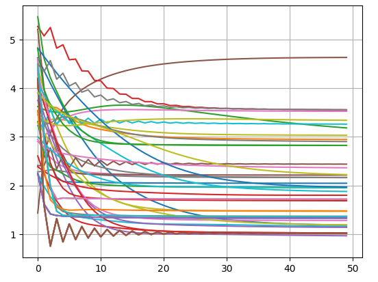

<h3>Description for exercise 6-1</h3>

The main goal is to understand what lies behind optimizers.
1. https://www.tensorflow.org/guide/core/optimizers_core
2. https://docs.pytorch.org/tutorials/beginner/blitz/autograd_tutorial.html
  
3. https://web.stanford.edu/~jurafsky/slp3/old_dec21/7.pdf - (Neural Networks and NeuralLanguage Models) - For informational purposes only, to provide a broader perspective.
  
<h4>About the notebook file</h4>

File `Untitled1 - 18-11-2026 - ex_6-1.ipynb` .
  
What exactly is a linear operation in neural networks? What precisely is `X W + B`? etc.
  
It is best to start with a simple example that corresponds to `xw+b`, the linear function `y = 3 * x + 2`. This is a straightforward when we know `y`. In the context of a neural network (NN), this is the `target`, `label`, or `class`. So if `y = 7`, then `7 = 3 * x + 2`, what is `x`?
  
And this is precisely where the file `Untitled1 - 18-11-2026 - ex_6-1.ipynb` begins. In the initial code blocks, I attempt to determine this value manually by trial and error and subsequently calculate it using `loss_fn` functions:
1.  y - x
2. (y - x) ** 2 ` # MSE, from code block [32] `
3. Cross Entropy, ` from code block [44] `

<h4>Summary </h4>

Okay, this is naive and weak, but exercise ` 6-1 ` is just there to provide a starting point. 

<h4>Multiple nodes</h4>

Do not take this graph seriously. It likely comes from the MLP at the end of this exercise, which has no activation function, and it’s based on 50 steps of the training loop. https://github.com/karpathy/nn-zero-to-hero/blob/master/lectures/makemore/makemore_part1_bigrams.ipynb . It's just an example plot.

So, for many loss values, those fed into (let's say) CrossEntropy the individual values BEFORE the `.mean()` operation is applied look something like this. This is just an example. That is why the `.mean()` operation aggregates them together in a certain way.
  
TODO
    
<h4>Update - Generally, it doesn't matter, but it’s good to have all the files in one place.</h4>

File `Untitled5 - ex6-1 - multiple losses.ipynb` . I found the code that collected these loss values ​​over time and created this plot. Unfortunately, I don’t remember the specific test I don’t have a record of it, so I cannot generate the exact same plot as the one shown above. As you can see, I tested with multiple layers and the addition of parameters, take a look at `#params = {W1, W2, W3, W4}`. But I don't remember this exercise. However. In listing [11], there is the initialization. In [14], the training loop. In [17], a plot. Now, note that this is for a single word, look at the beginning of [11]: `for w in words[:1]:` it processes only one word. You can gradually increase this to 2, 3, and so on. Furthermore, what I mentioned above is covered at the end, from [21] to [23]. Specifically, the `loss` and `torch.tensor(arr_losses)[-1].mean()` values ​​are identical. In other words, this represents the plot both BEFORE AND AFTER applying `.mean()`.
  
Optimizers from the PyTorch API are already being used here from what I see, but previously it was likely done manually, something like `W1.data += -(LR) * W1.grad` . And maybe there were 30 words instead of 1, plus a `logits = act(logits)` after the first linear layer, after `logits = xenc @ W1`. Perhaps a second linear layer after the activation, like in an MLP. A second option. Just a single linear operation, `logits = xenc @ W1`, with no activation function. But this time, using 1000 words somewhere between 1000 and 3000. Not the entire dataset, but a larger subset specifically 1000 words: `for w in words[:1000]:`. The network ended up with 729 parameters, consisting solely of `W1`. I then performed a manual update `W1.data += -(50) * W1.grad`. The result is quite similar. 
  
But it doesn’t matter. In any case, this is the code.
